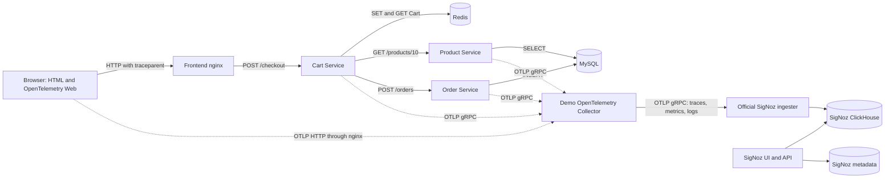
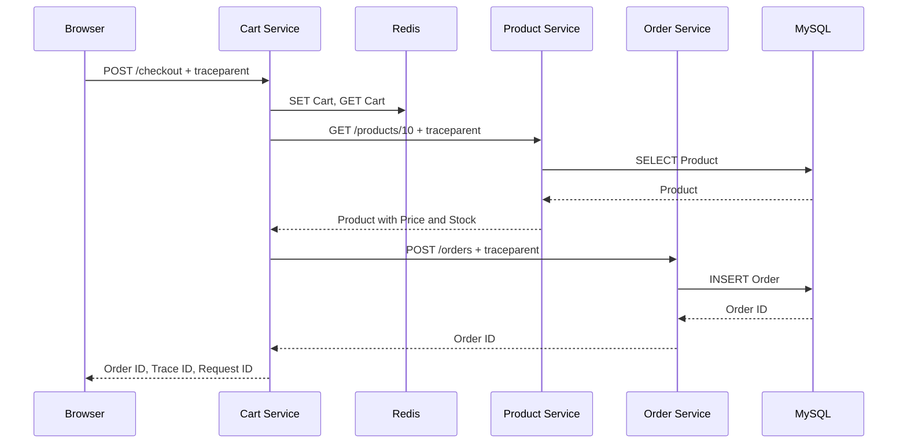

# Checkout observability demo

Run a local Checkout through a browser, three Go services, MySQL, and Redis. Use SigNoz to find the service or database operation that caused a delay or failure.

The demo uses Docker Compose. It does not need Kubernetes or a cloud account.

## Start

Install Docker Engine with Docker Compose v2.20 or later. Allocate at least 4 CPUs and preferably 8 GB of memory to Docker. The first start needs internet access to get images, build dependencies, and the official SigNoz histogram helper. First-start database migrations can take several minutes.

Run these commands from this directory:

```sh
make up
```

Without Make:

```sh
docker compose up -d --build --wait --wait-timeout 600
./scripts/wait-ready.sh
```

Open:

| Component | Host URL |
|---|---|
| Checkout page | http://localhost:18000 |
| Cart Service | http://localhost:18080/checkout |
| SigNoz | http://localhost:18081 |

Open SigNoz and complete its local account setup on the first visit. The demo can ingest telemetry before this setup. No cloud ingestion key is needed.

On the Checkout page, keep Product ID `10`, Quantity `2`, and Scenario `normal`. Select **Checkout**. The page shows the Order ID and Trace ID. Select **Copy Trace ID**.

```sh
make demo-normal
make logs
```

Stop the stack and keep its data:

```sh
make down
```

`make up` starts it again. To remove **all demo data**, including Orders, telemetry, and the SigNoz account, use `docker compose down -v`. MySQL seeds Product `10` only when its data volume is empty. The included SigNoz configuration uses fixed container and volume names; run one copy of this demo at a time.

## Architecture

See [all demo flow diagrams](docs/flows.md) for startup, all seven Scenarios, validation failures, lost responses, logs, telemetry, and Collector outage.



Cart Service calls Product Service, then Order Service. Product Service does not call Order Service. Their spans are separate children of the Cart request. MySQL and Redis spans describe client operations inside the service that makes the call. These databases do not run an OpenTelemetry SDK.

| Component | Responsibility |
|---|---|
| Frontend | Form, click instrumentation, Checkout span, fetch instrumentation, Trace ID display |
| Cart Service | Validate Checkout, store and read Cart, get Product, check Stock, request Order |
| Product Service | Read Product from MySQL |
| Order Service | Validate Order values, calculate total amount, insert Order into MySQL |
| MySQL | Product and Order data; automatic schema and seed |
| Redis | Cart data at `cart:<user_id>`, with a one-hour expiry |
| Demo Collector | Receive OTLP, limit memory, batch signals, forward to SigNoz |
| SigNoz | Store, query, and display telemetry |

The official SigNoz stack includes ClickHouse, ClickHouse Keeper, PostgreSQL, an ingester, and migration/helper jobs. It is generated by Foundry and included in the root Compose file. Application telemetry always goes through the demo Collector. Applications never write to the SigNoz database.

### Hostnames

All containers share `demo-signoz-network`. Inside a container, `localhost` means that container.

| Caller | Destination |
|---|---|
| nginx | `http://cart-service:8080` |
| Cart Service | `http://product-service:8080`, `http://order-service:8080` |
| Go services | `mysql:3306`, `redis:6379`, as applicable |
| Go telemetry exporters | `http://otel-collector:4317` |
| Browser exporter | `/telemetry/v1/traces` on the frontend origin |
| nginx telemetry proxy | `http://otel-collector:4318/v1/traces` |
| Demo Collector | `ingester:4317` |

Only the frontend, Cart API, and SigNoz UI have host ports. These ports bind to `127.0.0.1`. MySQL and SigNoz credentials in Compose are local demo values. Do not expose this stack to an untrusted network.

## Checkout rules and APIs

Price is a whole IDR integer. Product `10` has Price `100000` and Stock `10`. Stock stays fixed so each presentation can repeat. Each successful Checkout creates a new Order. There is no payment, Stock reservation, or duplicate-request protection.

Cart data comes from the current Checkout request. Cart Service stores it in Redis, then reads it back. A local lock keeps those two operations together for this single-replica demo. Cart Service ignores a submitted Price and gets Price from Product Service. Order Service checks integer overflow before calculating the total amount. The internal Order API is trusted and is not published to the host.

```sh
curl -i http://localhost:18080/checkout?scenario=normal \
  -H 'Content-Type: application/json' \
  -H 'X-Request-Id: demo-request-1001' \
  -d '{"user_id":1001,"product_id":10,"quantity":2}'
```

Example response (IDs vary):

```json
{"success":true,"order_id":123,"trace_id":"4bf92f3577b34da6a3ce929d0e0e4736"}
```

The response also has `X-Trace-Id` and `X-Request-Id` headers.

| Service | Method and route | Input or result |
|---|---|---|
| Cart | `POST /checkout` | `user_id`, `product_id`, `quantity`; returns Order ID and Trace ID |
| Product | `GET /products/{id}` | Returns `id`, `name`, `price`, `stock` |
| Order | `POST /orders` | `user_id`, `product_id`, `quantity`, `price`; returns Order ID |
| All Go services | `GET /healthz` | Liveness check; excluded from telemetry |

The IDs and Quantity must be positive integers. Quantity is limited to 1,000,000 and then checked against Stock. Requests must use `application/json` and must not exceed 16 KiB. Invalid input returns HTTP 400, excessive body size 413, and unsupported content type 415. Unknown Products return 404. Error responses contain `success: false`, an `error` code, and `trace_id`.

The page disables the button while Checkout runs. Neither nginx nor the application retries a Checkout POST. If the connection fails after an Order was stored, inspect the Trace ID before submitting again.

## How OpenTelemetry works

A span measures one operation. A trace connects related spans through their parent Span IDs. Each service has one resource with its `service.name`.

The frontend uses the Web SDK, `ZoneContextManager`, user interaction instrumentation, and fetch instrumentation. The standard `checkout button` span describes the click handler. A child `Checkout` span stays open until the asynchronous result is handled; this is the span to use for full browser Checkout duration and outcome. Fetch instrumentation adds `traceparent` to the same-origin request.

Go uses `otelhttp` for inbound and outbound HTTP, `otelsql` for `database/sql`, and `redisotel` for Redis. Every downstream operation receives the request's `context.Context`. The HTTP transport injects W3C Trace Context. The next server extracts it and continues the trace. No downstream service starts a new root when a valid parent exists.

The browser and backend requests use the same frontend origin through nginx, so CORS is not needed. Cart returns `Access-Control-Expose-Headers: X-Trace-Id, X-Request-Id` for header visibility, but a separate-origin frontend would also need a deliberate CORS policy.



New demo traces are sampled at 100%. Backend parent-based sampling respects an incoming unsampled parent. HTTP calls have timeouts, and request work has a six-second deadline. Failed operations record an error event, a safe error code, and error span status. A handled Stock failure also marks the Cart span as an application error, although the Product HTTP response is successful.

OTLP/gRPC carries backend traces, metrics, and logs to the demo Collector. OTLP/HTTP carries browser traces through nginx. The Collector has separate traces, metrics, and logs pipelines, with `memory_limiter`, `batch`, and an OTLP/gRPC exporter to SigNoz. No stdout log scraper is needed.

Exports run asynchronously with bounded queues and timeouts. A Collector outage must not fail Checkout. Telemetry can be lost during an outage or host suspension; this demo does not provide durable telemetry delivery. Startup and export errors remain visible in container logs.

## Trace ID, Request ID, and logs

| Identifier | Meaning |
|---|---|
| Trace ID | One distributed operation across browser and services |
| Span ID | One operation inside that trace |
| Request ID | One HTTP request |

A valid incoming `X-Request-Id` is reused. Otherwise, the server generates one. Accepted values contain 1–128 letters, digits, periods, underscores, colons, or hyphens. Each downstream HTTP request gets a separate Request ID. All participating requests keep the same Trace ID.

Go writes JSON logs to stdout and sends the same request log through the official `otelslog` bridge. Request context supplies the native OTLP Trace ID and Span ID. SigNoz can join these records to spans without parsing the JSON body.

Completed request logs contain `timestamp`, `level`, `service.name`, `trace_id`, `span_id`, `request_id`, `http.method`, `http.route`, `http.status_code`, and `duration_ms`. Error logs also contain `error.type` and `error.message`. Startup logs have no request or trace context.

### Body and header capture

The request body belongs in a structured log, not in a normal span attribute. Spans show timing and relationships; correlated logs hold the sanitized request detail.

All JSON body fields remain visible except sensitive fields. Redaction applies recursively to nested objects and arrays. It replaces password, token, access_token, refresh_token, authorization, api_key, credit_card, card_number, cvv, cookie, session, and related sensitive field names with `[REDACTED]`. Matching ignores case and common separators. The body limit also limits log size. Malformed or unreadable bodies are omitted, not logged as raw text. Integer values stay numeric when possible; other JSON numbers are kept as text to preserve their exact value in OTLP.

Only these request headers are captured: `content-type`, `accept`, `user-agent`, `x-request-id`, and `x-client-version`. Authorization, Cookie, Set-Cookie, and API-key headers are excluded. Capturing every header would risk storing credentials. SQL statements use placeholders, with no parameter values. Redis command arguments are not captured.

Use synthetic data for this demo. Field-name redaction cannot find a secret placed in an unrelated free-text field. The chosen all-fields body policy is for demonstration, not a general production policy.

## Metrics

| Metric | Meaning |
|---|---|
| `demo.http.requests` | Completed requests on application routes |
| `demo.http.duration` | Request duration histogram, in seconds |
| `demo.http.errors` | Responses with status 400 or higher |
| `demo.checkout.count` | Checkout attempts, including invalid requests |
| `demo.checkout.success` | Successful Checkouts |
| `demo.checkout.failure` | Failed Checkouts |

HTTP metrics use method, route template, and status code. They do not use User, Order, Trace, Span, or Request IDs as labels. The SDK also exports HTTP instrumentation metrics, MySQL connection-pool metrics, and Redis client connection metrics. These are client metrics, not a complete MySQL or Redis server monitoring setup.

Open the SigNoz metric explorer and select a `demo.*` metric. Generate several requests and allow at least 10 seconds for export and ingestion. Use a rate for counters and a percentile for the duration histogram. Some stored histogram series have `.bucket`, `.count`, or `.sum` suffixes.

## Scenarios and expected traces

Use the page's Scenario selector, `make demo-<scenario>`, or `POST /checkout?scenario=<scenario>`. An unknown Scenario returns HTTP 400 with `INVALID_SCENARIO`.

Normal trace, with some library-specific prepare/statement spans omitted:

```text
checkout button                     frontend click handler
└── Checkout                         full browser operation
    └── HTTP POST                    browser fetch
        └── POST /checkout           Cart Service
            ├── Redis SET
            ├── Redis GET
            ├── HTTP GET             Cart HTTP client
            │   └── GET /products/{id}   Product Service
            │       └── SELECT Product  MySQL
            └── HTTP POST            Cart HTTP client
                └── POST /orders     Order Service
                    └── INSERT Order MySQL
```

All spans share one Trace ID. Requests from curl start at Cart Service and have no browser spans.

| Scenario | Command | Expected result and trace change |
|---|---|---|
| normal | `make demo-normal` | HTTP 200; full trace; one Order |
| slow-product | `make demo-slow-product` | HTTP 200; Product server span includes a 1.5-second application delay before its SQL query |
| slow-db | `make demo-slow-db` | HTTP 200; Order Service → MySQL `SELECT SLEEP(1.5)` takes about 1.5 seconds, then INSERT runs |
| redis-slow | `make demo-redis-slow` | HTTP 200; Redis GET span includes a 1.5-second injected client delay |
| product-error | `make demo-product-error` | Cart HTTP 502 `PRODUCT_ERROR`; Product HTTP 500 error span; no Order call |
| out-of-stock | `make demo-out-of-stock` | Cart HTTP 409 `OUT_OF_STOCK`; Product returns Stock 0; Cart span is an error; no Order call |
| order-error | `make demo-order-error` | Cart HTTP 502 `ORDER_ERROR`; Order HTTP 500; MySQL INSERT fails a foreign key check; no Order stored |

`slow-db` executes a real slow query; it does not claim that the INSERT itself is slow. `redis-slow` is an injected delay inside the client GET span, not a claim that Redis server processing is slow. The Redis span has `demo.delay.injected=true`. `out-of-stock` changes the response only; stored Stock remains 10.

## Find traces and correlated logs

1. Generate a Checkout and copy its Trace ID.
2. Open SigNoz at http://localhost:18081 and sign in.
3. Open **Traces**. Choose a time range that includes the request, such as the last 15 minutes.
4. Add a filter for `trace_id` equal to the copied value. Run the query and open the trace.
5. Expand Cart Service and its children. Select a span to inspect its duration, attributes, and events.
6. Use **Go to related logs** from the trace or span. If the UI offers a **Related Signals / Logs** tab, use that tab.
7. For all service logs, open Logs Explorer and filter `trace_id` to the same value. A selected-span view can show only that span's logs.
8. Compare `service.name`, `span_id`, and `request_id`. Inspect `request.body` and `error.type`.

These steps follow the [SigNoz trace explorer guide](https://signoz.io/docs/userguide/traces/) and [log correlation guide](https://signoz.io/docs/traces-management/guides/correlate-traces-and-logs/). UI labels can differ between versions. Allow several seconds for batched export. If a trace is missing, check the time range, refresh, and run `docker compose logs otel-collector ingester`.

## Observability Demo Walkthrough

### Demo 1 — Normal Checkout

1. Open the frontend and select `normal`.
2. Select Checkout. Show the Order ID and copy the Trace ID.
3. Find that Trace ID in SigNoz.
4. Show the click span, full Checkout span, and browser fetch span.
5. Show Cart Service, Redis SET/GET, Product Service, and its MySQL SELECT.
6. Show Order Service and its MySQL INSERT.
7. Open related logs. Show the shared Trace ID and the different Request IDs.
8. Show the safe request fields. Explain that the submitted body is in the log, not the span.

### Demo 2 — Slow Product Service

1. Select `slow-product`, then Checkout.
2. Copy the Trace ID and open the trace.
3. Select the frontend Checkout span to see total duration.
4. Find the Product server span that takes about 1.5 seconds.
5. Compare it with the short SQL span. The injected application delay, not SQL, consumes most of the time.

### Demo 3 — Slow Database

1. Select `slow-db`, then Checkout.
2. Open the trace and expand Cart → Order → MySQL.
3. Find `SELECT SLEEP(1.5)`. It consumes most of the Order duration.
4. Compare it with the INSERT that follows.
5. Explain: “Checkout is slow” gives only a symptom. The child span identifies the database operation to investigate.

For example, a 2.5-second Checkout with 2.3 seconds in Order Service and 2.2 seconds in one SQL operation directs the investigation to that operation. Actual times depend on the local machine.

### Demo 4 — Application Error

1. Select `out-of-stock`, then Checkout.
2. Show the failed result and the Trace ID still shown to the User.
3. Open the trace. Show the error on the full browser Checkout span and Cart span.
4. Show the successful Product request with insufficient Stock, and the absence of an Order request.
5. Open the Cart log. Show HTTP 409, `OUT_OF_STOCK`, sanitized body, Trace ID, and Request ID.

Then compare `product-error` and `order-error`. Their traces identify different failure sources. Use `redis-slow` to show how the same workflow finds a slow Cart dependency.

## Tests and development

Running the application needs only Docker Compose and a POSIX shell. Local tests also need Go 1.27.1, Node.js 24, npm, and Python 3. Browser checks use Playwright Chromium.

```sh
make test
make verify
cd frontend
npm ci
npx playwright install chromium
cd ..
make test-browser
make verify-outage
```

On Linux, Playwright may also need OS libraries: use `npx playwright install --with-deps chromium` from `frontend` if they are absent.

- `make test`: build, Go race tests, and vet. Covers Request ID handling, body redaction, safe headers, Checkout rules, propagation, metrics, and Scenarios.
- `make verify`: real HTTP requests, MySQL Order counts, all seven Scenarios, stored spans, parent links, native log correlation, and privacy checks.
- `make test-browser`: real headless Chromium; form, fetch traceparent, copy button, shared trace, MySQL/Redis spans, and failed Checkout status.
- `make verify-outage`: stops only the demo Collector, checks that Checkout still works, and restores the Collector in a `finally` block. Run `make verify` after it to check new telemetry after recovery.

Run live tests without other traffic so Order-count assertions remain exact. Tests create Orders. Verification scripts read SigNoz storage to check ingestion; application code still sends only OTLP. Test artifacts are written to `artifacts/` and are not project source files.

See [the phase verification record](docs/verification.md) for measured evidence and limitations. Stored telemetry and browser behavior were checked automatically; the first-account SigNoz UI setup remains a manual step.

### Source layout

```text
cmd/{cart-service,product-service,order-service}/main.go
internal/demo/       Go handlers, telemetry, logs, metrics, Scenarios, tests
frontend/            HTML, JavaScript, nginx, browser tests
mysql/init.sql       Schema and Product seed
otel-collector/      Demo Collector configuration
signoz/              Official Foundry casting, lock, generated files, license
scripts/             Traffic and live verification scripts
docs/                Design, compatibility review, phase evidence
```

One Go module serves three separate binaries. Shared middleware stays in one package to keep the demo small. Domain terms are defined in [CONTEXT.md](CONTEXT.md). See [design decisions](docs/design.md) and [package compatibility](docs/compatibility.md).

### SigNoz configuration

The generated deployment is included in the repository; Foundry is not needed to run it. To regenerate it with Foundry 0.3.0:

```sh
cd signoz
foundryctl --no-ledger --no-updater -f casting.yaml -p pours forge
```

Keep changes in `casting.yaml` patches. Do not edit generated files by hand. Patches bind the UI to loopback, keep ingestion ports internal, pin images, order startup after migrations, and use the generated static ingester configuration. Static configuration permits ingestion before account setup. SigNoz remote Collector management is not used. The upstream license is included in `signoz/LICENSE`.

### Troubleshooting

- Startup fails: run `docker compose ps -a` and `docker compose logs --tail=100`. Migration and helper containers normally exit with code 0. Check Docker memory, disk space, and image-download access.
- Port conflict: stop the process that uses 18000, 18080, or 18081, or edit the host port mapping and frontend SigNoz link.
- No telemetry: run `./scripts/wait-ready.sh`, make a new Checkout, wait 10 seconds, and check both Collector logs.
- Missing browser spans: use the frontend, not curl. Check that `/telemetry/v1/traces` returns HTTP 200 in browser network tools.
- Split traces: check `traceparent` on `/checkout`. The browser, Cart response, and page must show the same Trace ID.
- No related logs: filter Logs Explorer by native `trace_id` and the correct time range. Startup logs have no Trace ID.
- Host resumed from sleep: make a fresh request. Queued telemetry from the suspension may have been dropped.
- Seed changed but Product did not: SQL initialization runs only for an empty MySQL volume. Do not remove data unless you intend to reset the demo.
