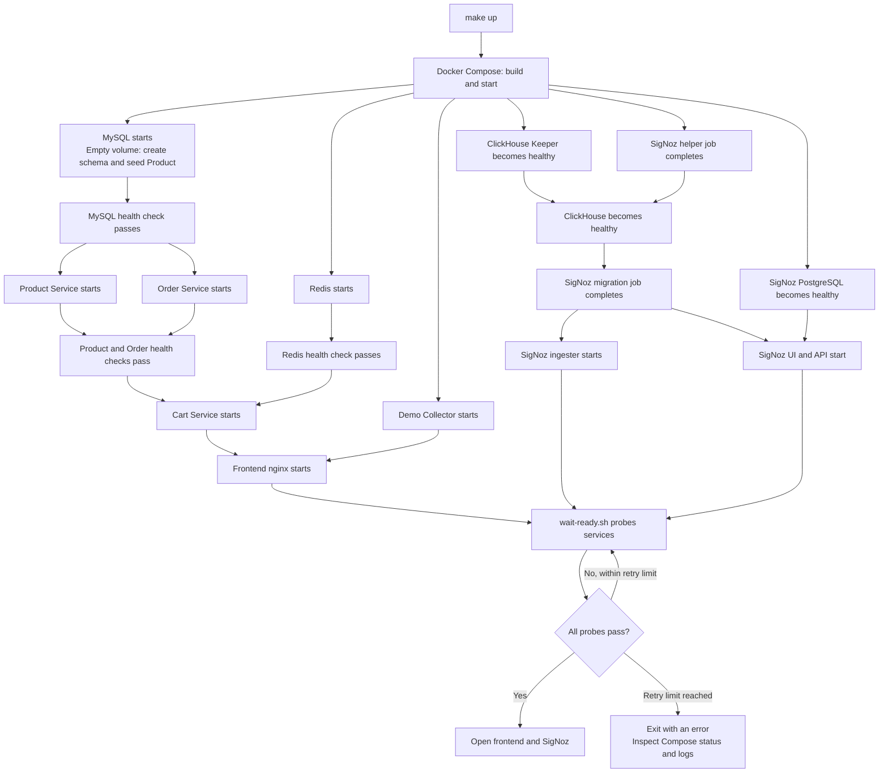
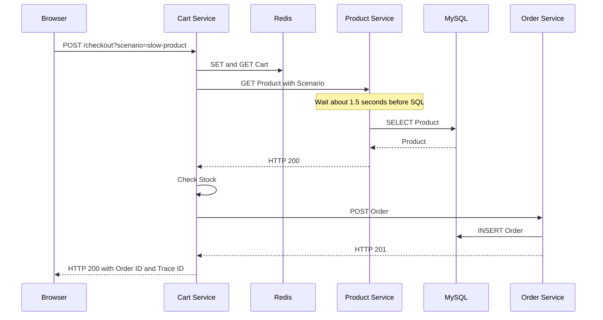
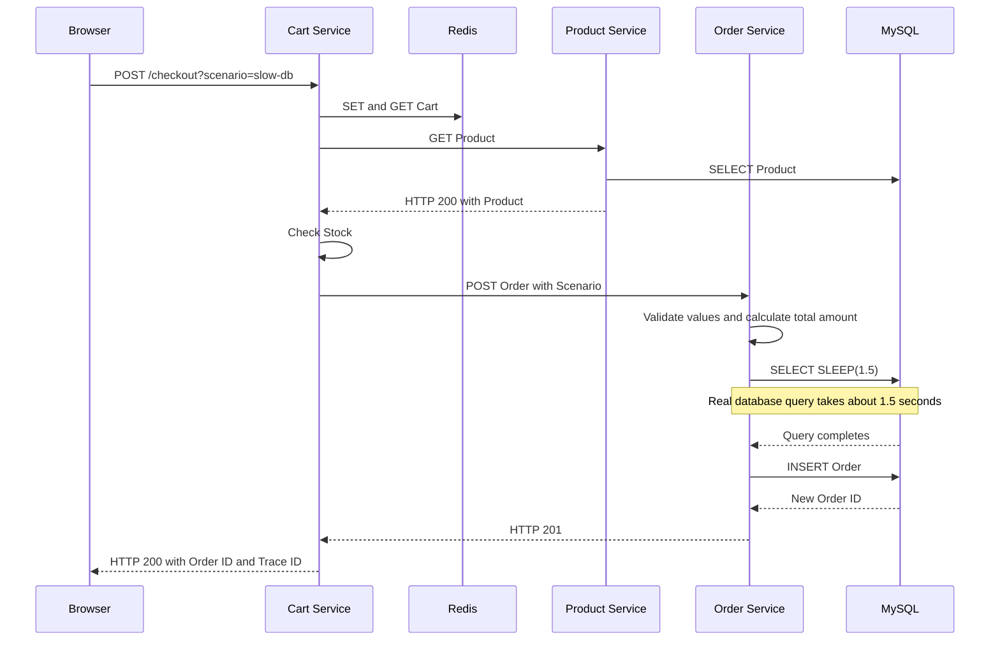
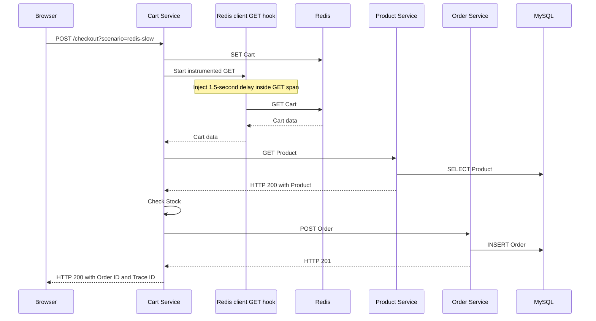
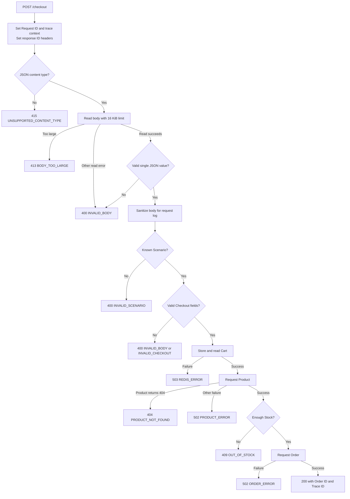
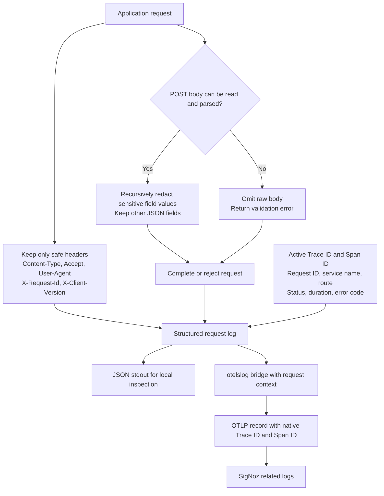
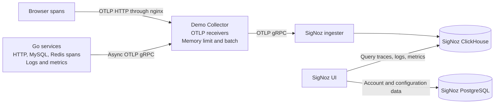
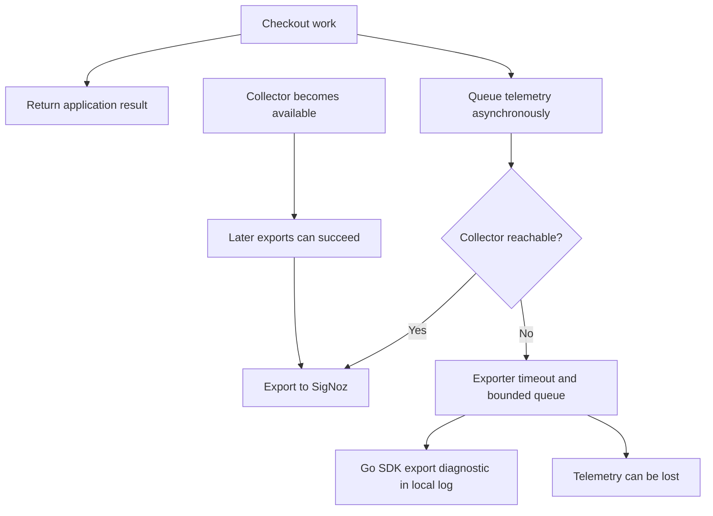
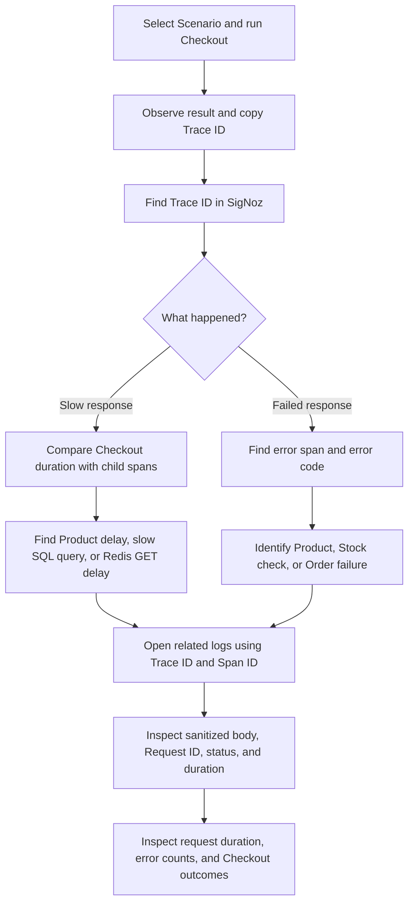

# Demo flow diagrams

These diagrams show the implemented startup, Checkout Scenarios, error handling, and telemetry paths. See the [README](../README.md) for run commands and the presentation walkthrough.

## Read the diagrams

- Solid arrows show the next operation or request. Dashed arrows show responses in sequence diagrams.
- Cart Service calls Product Service, then Order Service. Product Service does not call Order Service.
- Browser requests pass through frontend nginx. Some Scenario diagrams omit nginx to keep the service path clear.
- Every span in one Checkout has the same Trace ID. Each downstream HTTP request gets a separate Request ID.
- MySQL and Redis spans are client spans inside the calling Go service. The databases do not export these spans themselves.
- Every successful Checkout creates a separate Order. Stored Stock stays at 10.

## 1. Startup

Run `make up`. Compose starts the application and SigNoz components. The readiness script then checks Cart Service, both Collectors, and the SigNoz API.



The SigNoz local account is needed to use its UI. It is not needed for telemetry ingestion. `make down` stops the stack and keeps data volumes. `docker compose down -v` also deletes demo data.

## 2. Browser and request context

```mermaid
sequenceDiagram
    actor User
    participant Browser
    participant Nginx as Frontend nginx
    participant Cart as Cart Service
    participant Downstream as Product or Order Service
    User->>Browser: Select Checkout
    Browser->>Browser: Validate form and disable button
    Browser->>Browser: Start click span and child Checkout span
    Browser->>Nginx: POST /checkout with traceparent
    Nginx->>Cart: Forward request and traceparent
    Cart->>Cart: Continue trace; reuse valid Request ID or generate one
    Cart->>Downstream: Request with traceparent and new Request ID
    Downstream->>Downstream: Continue same trace
    Downstream-->>Cart: Result or error
    Cart-->>Nginx: Response with Trace ID and Request ID headers
    Nginx-->>Browser: Forward response
    Browser->>Browser: Show result and Trace ID
    Browser->>Browser: Mark Checkout error if failed; end span; enable button
    User->>Browser: Copy Trace ID
```

The standard click span measures the event handler. Its child `Checkout` span measures the asynchronous operation through result handling. Use the latter to inspect full browser duration and outcome. A curl request has no browser spans; its trace starts at Cart Service unless it supplies a valid parent.

## 3. Normal Checkout

Trigger: `make demo-normal` or select `normal` on the page.

```mermaid
sequenceDiagram
    participant Browser
    participant Cart as Cart Service
    participant Redis
    participant Product as Product Service
    participant Order as Order Service
    participant MySQL
    Browser->>Cart: POST /checkout: User 1001, Product 10, Quantity 2
    Cart->>Cart: Validate values; ignore submitted Price
    Cart->>Redis: SET cart:1001 with one-hour expiry
    Cart->>Redis: GET cart:1001
    Redis-->>Cart: Submitted Cart
    Cart->>Product: GET /products/10
    Product->>MySQL: SELECT Product
    MySQL-->>Product: Price 100000, Stock 10
    Product-->>Cart: HTTP 200 with Product
    Cart->>Cart: Check Quantity against Stock
    Cart->>Order: POST /orders with Product Price
    Order->>Order: Validate values; calculate total amount 200000
    Order->>MySQL: INSERT Order
    MySQL-->>Order: New Order ID
    Order-->>Cart: HTTP 201 with Order ID
    Cart-->>Browser: HTTP 200 with Order ID and Trace ID
```

Inspect Redis SET/GET, Product SELECT, and Order INSERT in one trace. Expect one new Order and no error spans after connection setup.

## 4. Slow Product Service

Trigger: `make demo-slow-product` or select `slow-product`.



The Product server span is long. Its SQL child is short. This identifies time spent in Product Service before the query. One Order is stored.

## 5. Slow database

Trigger: `make demo-slow-db` or select `slow-db`.



Expand Cart → Order → MySQL. The slow child is `SELECT SLEEP(1.5)`, not the INSERT. One Order is stored.

## 6. Slow Redis operation

Trigger: `make demo-redis-slow` or select `redis-slow`.



The Redis GET span is long and has `demo.delay.injected=true`. The delay is in the client hook; it does not make Redis server processing slow. One Order is stored.

## 7. Product Service error

Trigger: `make demo-product-error` or select `product-error`.

```mermaid
sequenceDiagram
    participant Browser
    participant Cart as Cart Service
    participant Redis
    participant Product as Product Service
    Browser->>Cart: POST /checkout?scenario=product-error
    Cart->>Redis: SET and GET Cart
    Cart->>Product: GET Product with Scenario
    Product->>Product: Record PRODUCT_UNAVAILABLE; mark span as error
    Product-->>Cart: HTTP 500 with PRODUCT_UNAVAILABLE
    Cart->>Cart: Record PRODUCT_ERROR; mark span as error
    Cart-->>Browser: HTTP 502 with PRODUCT_ERROR and Trace ID
    Browser->>Browser: Show failure and Trace ID; mark Checkout span as error
    Note over Cart,Product: No Product SQL query and no Order request
```

Inspect the Product server error and its correlated request log. Cart reports a downstream failure. No Order is stored.

## 8. Insufficient Stock

Trigger: `make demo-out-of-stock` or select `out-of-stock`. A normal Checkout with Quantity greater than available Stock reaches the same Cart error path.

```mermaid
sequenceDiagram
    participant Browser
    participant Cart as Cart Service
    participant Redis
    participant Product as Product Service
    participant MySQL
    Browser->>Cart: POST /checkout?scenario=out-of-stock
    Cart->>Redis: SET and GET Cart
    Cart->>Product: GET Product with Scenario
    Product->>MySQL: SELECT Product
    MySQL-->>Product: Product with stored Stock 10
    Product->>Product: Set response Stock to 0
    Product-->>Cart: HTTP 200 with Stock 0
    Cart->>Cart: Quantity exceeds Stock
    Cart->>Cart: Record OUT_OF_STOCK; mark span as error
    Cart-->>Browser: HTTP 409 with OUT_OF_STOCK and Trace ID
    Browser->>Browser: Show failure and Trace ID; mark Checkout span as error
    Note over Cart,MySQL: No Order request; stored Stock stays 10
```

Product's HTTP request succeeds. The application error belongs to Cart's Stock check. No Order is stored.

## 9. Order creation error

Trigger: `make demo-order-error` or select `order-error`.

```mermaid
sequenceDiagram
    participant Browser
    participant Cart as Cart Service
    participant Redis
    participant Product as Product Service
    participant Order as Order Service
    participant MySQL
    Browser->>Cart: POST /checkout?scenario=order-error
    Cart->>Redis: SET and GET Cart
    Cart->>Product: GET Product
    Product->>MySQL: SELECT Product
    Product-->>Cart: HTTP 200 with Product
    Cart->>Cart: Check Stock
    Cart->>Order: POST Order with Scenario
    Order->>Order: Validate values and calculate total amount
    Order->>MySQL: INSERT with intentional Product ID -1
    MySQL-->>Order: Foreign key rejection
    Order->>Order: Record ORDER_CREATION_FAILED; mark span as error
    Order-->>Cart: HTTP 500 with ORDER_CREATION_FAILED
    Cart->>Cart: Record ORDER_ERROR; mark span as error
    Cart-->>Browser: HTTP 502 with ORDER_ERROR and Trace ID
    Browser->>Browser: Show failure and Trace ID; mark Checkout span as error
```

The SQL INSERT span, Order server span, and Cart server span identify the failure. The foreign key check prevents storage of the Order.

## 10. Validation and other dependency failures

These paths are implemented error handling, not extra named Scenarios. This diagram shows the response returned by Cart Service.



Errors returned by these application handlers contain a Trace ID and produce a correlated request log. A request rejected by nginx before it reaches Go can have a different response and no application trace. For example, nginx has its own 64 KiB body limit.

A timeout is reported through the operation that failed. For example, an unsuccessful Product call becomes `PRODUCT_ERROR`; an unsuccessful Order call becomes `ORDER_ERROR`. A failed Order call does not always prove that no Order was stored: a response can be lost after a successful INSERT.

## 11. Lost response and repeated Checkout

```mermaid
sequenceDiagram
    participant Browser
    participant Cart as Cart Service
    participant Order as Order Service
    participant MySQL
    Browser->>Cart: Checkout request
    Note over Cart: Redis and Product steps succeed
    Cart->>Order: Create Order
    Order->>MySQL: INSERT Order
    MySQL-->>Order: Order stored
    Order-->>Cart: Order ID
    Cart--xBrowser: Response is lost
    Browser->>Browser: Show that an Order may exist; keep browser Trace ID
    Note over Browser,MySQL: No automatic POST retry
    Browser->>Browser: Inspect trace and logs before another Checkout
    Note over Browser,MySQL: A later successful Checkout creates another Order
```

The demo has no duplicate-request protection. A network failure is different from the deterministic `order-error` Scenario, where MySQL rejects the INSERT.

## 12. Structured logs and privacy



Request bodies are not span attributes. Authorization, Cookie, Set-Cookie, and API-key headers are not captured. SQL uses placeholders without parameter values; Redis command arguments are disabled. Use synthetic data: field-name redaction cannot identify a secret placed in an unrelated free-text field.

## 13. Telemetry and Collector outage





Collector availability does not decide the Checkout response. Redis and MySQL availability still matter because Checkout needs their results. Run `make verify-outage` to test Collector loss and restoration, then `make verify` to check new telemetry.

## 14. Debugging with all three signals



Metrics show frequency and duration across requests. Traces show where one Checkout spent time or failed. Correlated logs show the sanitized request detail. Metric labels do not contain User, Order, Trace, Span, or Request IDs.

## Source and verification

These diagrams follow [the Go handlers](../internal/demo/app.go), [Scenario code](../internal/demo/scenarios.go), [request tracing](../internal/demo/tracing.go), [request logging](../internal/demo/logging.go), [frontend](../frontend/app.js), and [Compose configuration](../docker-compose.yml). See [verification evidence](verification.md) for the automated checks of all seven Scenarios, browser propagation, log correlation, metrics, and Collector outage.
